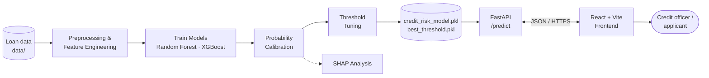

<div align="center">

# 🏦 Credit Risk Scoring

**An end-to-end, explainable machine-learning system that predicts the probability a borrower will default — from model training to a deployed REST API and web interface.**


</div>

---

## 📖 Table of Contents

- [Overview](#-overview)
- [Key Features](#-key-features)
- [System Architecture](#-system-architecture)
- [Machine Learning Approach](#-machine-learning-approach)
- [Input Features](#-input-features)
- [Tech Stack](#-tech-stack)
- [Project Structure](#-project-structure)
- [Getting Started](#-getting-started)
- [Configuration](#-configuration)
- [API Reference](#-api-reference)
- [Deployment](#-deployment-on-render)
- [Results](#-results)
- [Limitations & Responsible Use](#-limitations--responsible-use)
- [Roadmap](#-roadmap)
- [License](#-license)

---

## 🔍 Overview

Lenders need to decide quickly and fairly whether an applicant is likely to repay a loan. This project turns that decision into a data-driven pipeline:

1. **Learn** patterns of default from historical loan data using tree-based models (**Random Forest** and **XGBoost**).
2. **Calibrate** the model output so a predicted probability of `0.20` really means roughly a 20% chance of default.
3. **Explain** model behaviour with **SHAP**, showing which borrower attributes push risk up or down.
4. **Decide** using a **tuned decision threshold** (saved alongside the model) instead of a blind 0.5 cut-off.
5. **Serve** the final model through a **FastAPI** service and a **React** front end, deployed on **Render**.

> **Why not just accuracy?** In credit risk the *probability* matters as much as the label. Probabilities feed pricing, expected-loss estimates and approval cut-offs, so this project treats calibration, threshold selection and explainability as first-class requirements.

---

## ✨ Key Features

| Feature | Description |
|---|---|
| 🌲 **Multiple models** | Random Forest and XGBoost trained and compared on the same data |
| 🎯 **Probability calibration** | Raw scores are calibrated so outputs behave like real probabilities |
| ⚖️ **Tuned decision threshold** | The best threshold is chosen during training and shipped with the model (`best_threshold.pkl`) |
| 🔎 **SHAP explainability** | Global and per-applicant analysis of what drives predicted risk |
| ⚡ **REST API** | FastAPI with Pydantic-validated requests and auto-generated Swagger docs |
| 🖥️ **Web interface** | React (Vite) front end for submitting a loan application and viewing the result |
| 🚀 **Fast inference** | Model artefacts are loaded **once at start-up** via FastAPI's lifespan handler |
| ☁️ **One-click deploy** | `render.yaml` Blueprint provisions the API and the front end together |

---

## 🏗️ System Architecture



**Request flow:** the front end sends the 11 applicant fields → FastAPI validates them with Pydantic → the model returns a default probability via `predict_proba` → the probability is compared with the saved threshold → the API returns the probability, the class prediction, the threshold used and a `High Risk` / `Low Risk` label.

---

## 🧠 Machine Learning Approach

### Models

Two complementary tree-ensemble algorithms are trained and benchmarked:

#### 🌲 Random Forest
- A **bagging** ensemble: many decorrelated decision trees trained on bootstrap samples, with predictions averaged.
- Robust to noise and outliers, needs little tuning, and gives a strong, stable baseline.
- Averaged tree votes tend to produce *under-confident* probabilities near 0 and 1, which is why calibration matters.

#### ⚡ XGBoost
- A **gradient-boosting** ensemble: trees are built sequentially, each correcting the errors of the previous ones.
- Captures non-linear relationships and feature interactions, and handles missing values natively.
- Built-in regularisation (L1/L2, shrinkage, subsampling) helps control overfitting on tabular credit data.

| | Random Forest | XGBoost |
|---|---|---|
| Ensemble type | Bagging (parallel trees) | Boosting (sequential trees) |
| Strength | Stability, low variance | High predictive accuracy |
| Tuning effort | Low | Moderate |
| Needs calibration | Yes | Yes |

The trained model is saved with **joblib** and loaded by the API with a single `predict_proba` call on the raw application fields, so the preprocessing is packaged with the model and the API never re-implements it.

### Probability Calibration

Tree ensembles rank risky borrowers well, but their raw scores are often **not true probabilities**. Calibration is a post-processing step fitted on held-out data:

- **Platt scaling (sigmoid)**: maps raw scores to probabilities with a logistic curve; works well on smaller datasets.
- **Isotonic regression**: a flexible, non-parametric monotonic mapping; better on larger datasets.

Calibration quality is checked with:

- **Reliability curves**: predicted probability vs. observed default rate.
- **Brier score**: mean squared error of the predicted probabilities (lower is better).
- **Expected Calibration Error (ECE)**: average gap between confidence and actual frequency.

A calibrated probability supports business-meaningful cut-offs and expected-loss estimates (`PD × LGD × EAD`).

### Decision Threshold Tuning

Defaults are normally the **minority class**, so the standard 0.5 cut-off is rarely optimal. The training pipeline selects the **best threshold** on validation data (for example by maximising F1 or balancing precision and recall for the business need) and stores it in `best_threshold.pkl`.

At inference time:

```
default_prediction = 1  if  default_probability >= threshold  else  0
```

Lowering the threshold catches more defaulters but rejects more good customers. Raising it does the opposite. Because the threshold is saved separately from the model, it can be **re-tuned without retraining**.

### Explainability with SHAP

Credit decisions are high-stakes and regulated, so a black-box score is not enough. This project uses **[SHAP](https://github.com/shap/shap) (SHapley Additive exPlanations)**, which attributes each prediction to the input features using cooperative game theory.

- **Global explanations**: summary and bar plots show which features drive risk across the portfolio (for example interest rate, loan-to-income ratio, loan grade).
- **Local explanations**: for one applicant, SHAP shows which features pushed risk **up** and which pushed it **down** relative to the average borrower.
- **Dependence plots**: show how a feature's value changes its impact and reveal interactions.
- **Fast and exact for trees**: `TreeExplainer` computes SHAP values efficiently for both Random Forest and XGBoost.

SHAP supports transparency, model debugging, bias checks and "reason code" style feedback.

### Evaluation Metrics

Because accuracy can be misleading on imbalanced data, models are compared using:

- **ROC-AUC**: overall ranking quality
- **Precision, Recall, F1-score**: the trade-off between catching defaulters and rejecting good customers
- **Confusion matrix**: concrete counts of correct and incorrect decisions
- **Brier score and calibration curve**: probability quality

---

## 🧾 Input Features

The API expects the following 11 fields for each loan application:

| Field | Type | Description |
|---|---|---|
| `person_age` | integer | Applicant's age in years |
| `person_income` | float | Annual income |
| `person_home_ownership` | string | Home ownership status (e.g. `RENT`, `OWN`, `MORTGAGE`, `OTHER`) |
| `person_emp_length` | float | Length of employment in years |
| `loan_intent` | string | Purpose of the loan (e.g. `EDUCATION`, `MEDICAL`, `VENTURE`, `PERSONAL`, `HOMEIMPROVEMENT`, `DEBTCONSOLIDATION`) |
| `loan_grade` | string | Lender-assigned loan grade (e.g. `A` to `G`) |
| `loan_amnt` | float | Requested loan amount |
| `loan_int_rate` | float | Loan interest rate (%) |
| `loan_percent_income` | float | Loan amount as a fraction of income |
| `cb_person_default_on_file` | string | Whether the applicant has a prior default on file (`Y` / `N`) |
| `cb_person_cred_hist_length` | integer | Length of the applicant's credit history in years |

> The category values listed are typical for this schema. Use the same spellings the model was trained on.

---

## 🛠️ Tech Stack

| Layer | Technology |
|---|---|
| **Language** | Python 3.12 |
| **Data processing** | pandas |
| **Machine learning** | scikit-learn 1.6, XGBoost 3.x |
| **Explainability** | SHAP |
| **Model persistence** | joblib |
| **API** | FastAPI 0.115, Uvicorn, Pydantic 2 |
| **Frontend** | React, Vite, Node 22 |
| **Hosting** | Render (Blueprint via `render.yaml`) |

---

## 📁 Project Structure

```
Credit_Risk/
├── code/                    # Backend: FastAPI app (main.py) and model artefacts
│   ├── main.py              # API: lifespan model loading, CORS, /predict
│   ├── credit_risk_model.pkl  # Trained model / pipeline (joblib)
│   └── best_threshold.pkl     # Tuned decision threshold (joblib)
├── data/                    # Datasets used for training and evaluation
├── frontend/                # React (Vite) web application
├── .env                     # Local environment variables
├── render.yaml              # Render Blueprint: API + static frontend
├── requirements.txt         # Pinned Python dependencies
├── python-version           # Pinned Python version
└── README.md
```

> `main.py` looks for the two `.pkl` files **next to itself first, then in the repository root**, so either location works.

---

## 🚀 Getting Started

### Prerequisites

- **Python 3.12**
- **Node.js 22** and npm
- Git

### 1. Clone the repository

```bash
git clone https://github.com/AOISYNM/Credit_Risk.git
cd Credit_Risk
```

### 2. Run the backend

```bash
python -m venv .venv
source .venv/bin/activate        # Windows: .venv\Scripts\activate

pip install --upgrade pip
pip install -r requirements.txt

uvicorn main:app --app-dir code --reload --port 8000
```

- API root: <http://localhost:8000>
- Interactive docs (Swagger UI): <http://localhost:8000/docs>

> ⚠️ The model files must exist at start-up. If `credit_risk_model.pkl` or `best_threshold.pkl` is missing, the API fails with a `FileNotFoundError`.

### 3. Run the frontend

```bash
cd frontend
npm ci

# point the UI at your local API
echo "VITE_API_URL=http://localhost:8000" > .env.local

npm run dev
```

Open the URL Vite prints (usually <http://localhost:5173>). That origin is already allowed by the API's CORS settings.

### 4. Try the API directly

```bash
curl -X POST http://localhost:8000/predict \
  -H "Content-Type: application/json" \
  -d '{
        "person_age": 28,
        "person_income": 45000,
        "person_home_ownership": "RENT",
        "person_emp_length": 3,
        "loan_intent": "PERSONAL",
        "loan_grade": "C",
        "loan_amnt": 10000,
        "loan_int_rate": 13.5,
        "loan_percent_income": 0.22,
        "cb_person_default_on_file": "N",
        "cb_person_cred_hist_length": 4
      }'
```

---


## 📡 API Reference

FastAPI generates full interactive documentation at **`/docs`** (Swagger UI) and **`/redoc`**.

| Method | Endpoint | Description |
|---|---|---|
| `GET` | `/` | Health check (used by Render). Returns a simple message. |
| `POST` | `/predict` | Scores one loan application and returns the default probability and risk label |

### `POST /predict`

**Request body:** the 11 fields listed in [Input Features](#-input-features). Pydantic validates types, so a malformed request returns a clear `422` error rather than a silent bad prediction.

**Example response**

```json
{
  "default_probability": 0.4187,
  "default_prediction": 1,
  "threshold": 0.35,
  "Result": "High Risk"
}
```

| Field | Meaning |
|---|---|
| `default_probability` | Model's estimated probability that the borrower defaults (0 to 1) |
| `default_prediction` | `1` if `default_probability >= threshold`, otherwise `0` |
| `threshold` | The tuned decision threshold used for this prediction |
| `Result` | Human-readable label: `High Risk` or `Low Risk` |

---

## ☁️ Deployment on Render

The repository ships with a **Render Blueprint** (`render.yaml`) that deploys two services:

| Service | Type | Details |
|---|---|---|
| `credit-risk-api` | Web service (Python) | Installs `requirements.txt`, runs `uvicorn main:app --app-dir code`, health check on `/` |
| `credit-risk-web` | Static site | Builds `frontend/` with `npm ci && npm run build`, publishes `dist/` |


>  The `.pkl` files are tied to the library versions they were created with. Keep `scikit-learn` and `xgboost` pinned in `requirements.txt` to the versions used for training, otherwise loading or predicting may fail.

---

##  Results

<!-- TODO: replace the placeholders with your real numbers and add plots (e.g. an assets/ folder). -->

| Model | ROC-AUC | F1 | Brier (raw) | Brier (calibrated) |
|---|---|---|---|---|
| Random Forest | _TBD_ | _TBD_ | _TBD_ | _TBD_ |
| **XGBoost** | _TBD_ | _TBD_ | _TBD_ | _TBD_ |

**Selected decision threshold:** _TBD_

**Suggested visuals to add**

- ROC curves for both models
- Calibration curves before vs. after calibration
- SHAP summary plot (global feature importance)
- SHAP waterfall plot for a single applicant

---

##  Limitations & Responsible Use

- This is a **decision-support tool**, not an autonomous lending decision-maker. Final approvals should involve human review.
- Model quality depends on how **representative the training data** is; performance may degrade on populations or time periods unlike the training set.
- Historical credit data can encode **societal bias**. Review SHAP outputs and fairness metrics (for example across age groups) before any real-world use, and follow regulations on automated credit decisions and adverse-action explanations.
- Calibration and the decision threshold should be **re-checked periodically** (model drift) and after any retraining.

---

## 🗺️ Roadmap

- [ ] Return SHAP-based reason codes from the `/predict` endpoint and show them in the UI
- [ ] Add fairness / bias audit reports
- [ ] Hyperparameter tuning with cross-validation or Optuna
- [ ] Experiment tracking (e.g. MLflow)
- [ ] Docker image and CI pipeline (tests + linting)
- [ ] Monitoring for data drift and calibration decay


<div align="center">

**Built using Python, XGBoost, FastAPI and React.**

</div>